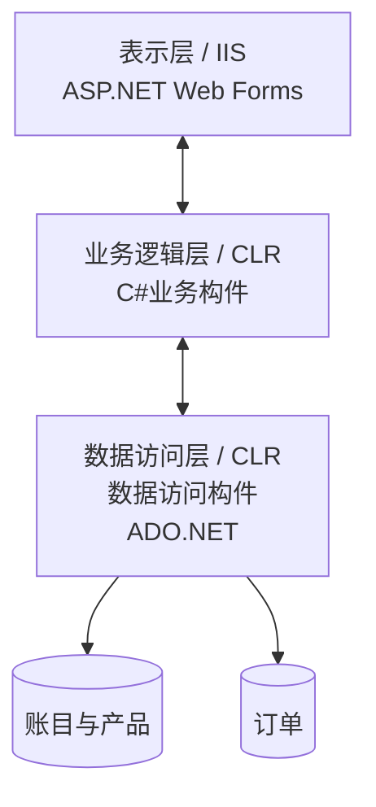
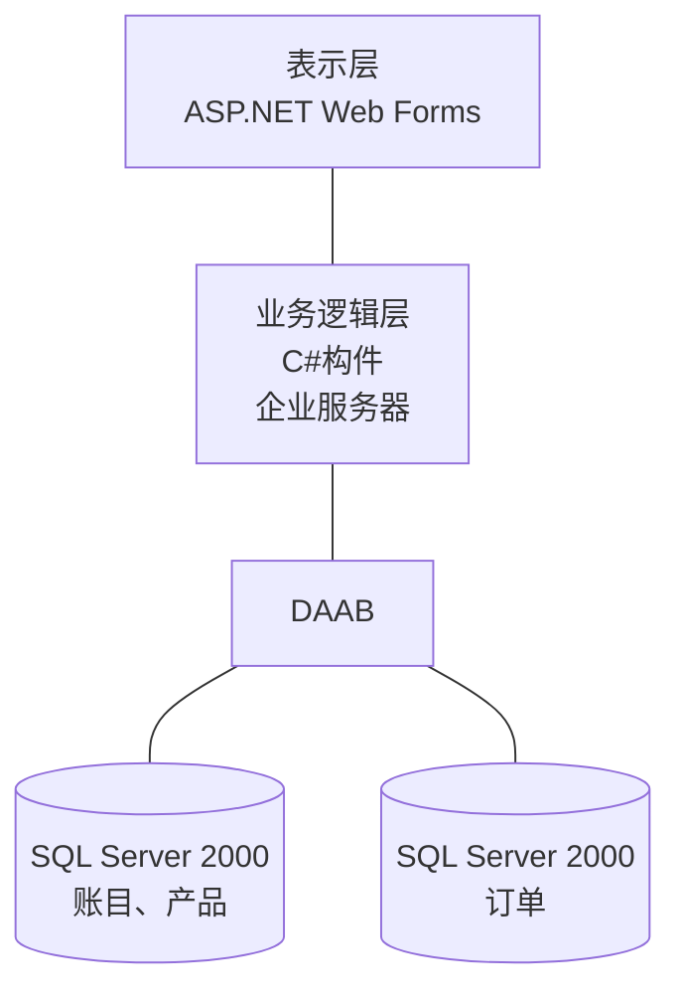
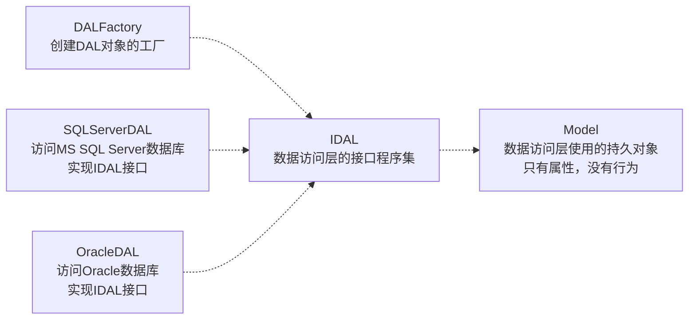
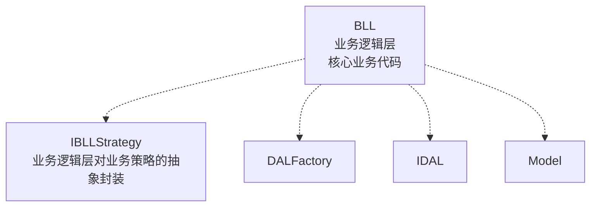
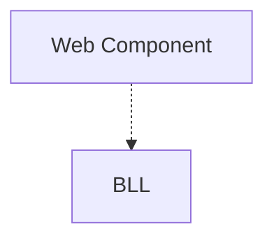
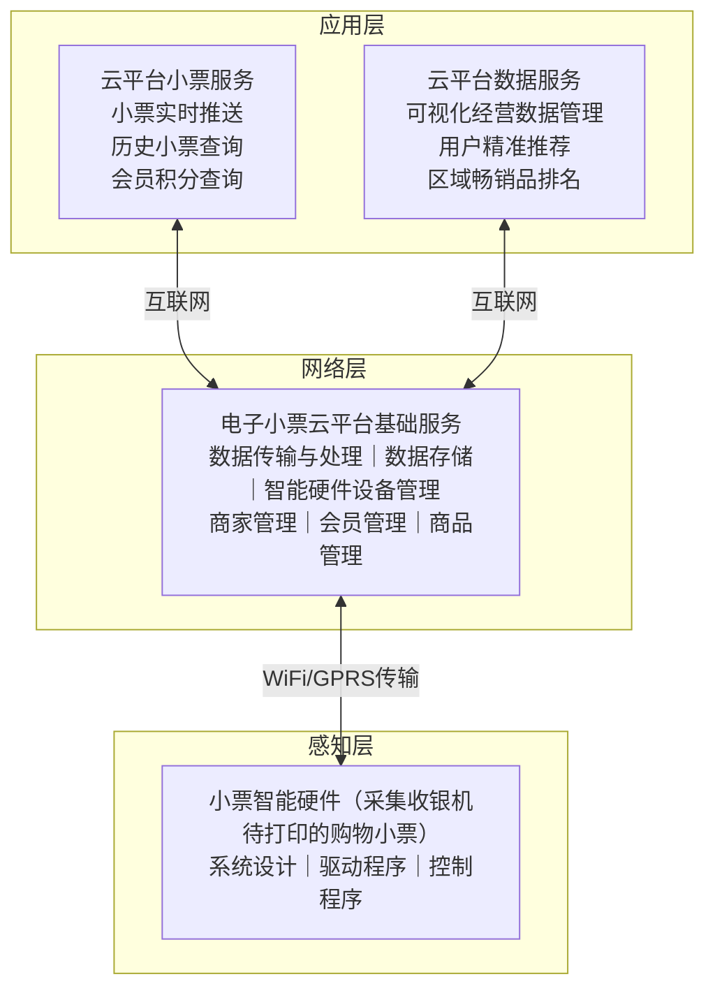
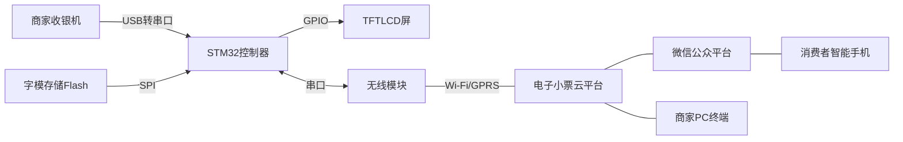

## 13.7 层次式架构案例分析

### 13.7.1 电子商务网站(网上商店PetShop)

> **编校注：** 本节原书将 .NET 相关名称排印为“.Net”“ASPNet”“Sql Client”等（如“展示，Net 企业系统开发的能力”“ASPNet设计的”），清洗稿统一按微软规范名转写为“.NET”“ASP.NET”“SQL Server”等，核对日期 `2026-09-07`。

PetShop是一个范例，微软用它来展示.NET企业系统开发的能力。PetShop随着版本的不断更新，至现在基于.NET 2.0的PetShop 4.0为止，整个设计逐渐变得成熟而优雅，有很多可以借鉴之处。PetShop是一个小型的项目，系统架构与代码都比较简单，却也凸现了许多颇有价值的设计与开发理念。

PetShop的表示层是用ASP.NET设计的，也就是说，它应是一个B/S系统。在.NET中，标准的B/S分层式结构如图 13-15所示。

随着PetShop版本的更新，其分层式结构也在不断完善，例如PetShop 2.0，就没有采用标准的三层式结构，如图 13-16所示。

> 图 13-15 .NET中标准的B/S分层式结构

> **结构化重绘说明：** 基于上述本地 PDF（SHA-256 `EE45900F4622D71539980CFE1BDDBCD898FBA97CA13ADA6DF1CBDC215135C2F8`）PDF 第485页 / 印刷第477页，核对日期 `2026-07-12`；不是教材原图。保留 IIS、CLR、ADO.NET 所在层次，前两组为原图双向箭头，数据访问构件分别指向“账目与产品”和“订单”数据库。

> 图 13-16 PetShop 2.0的体系架构

> **结构化重绘说明：** 基于上述本地 PDF（SHA-256 `EE45900F4622D71539980CFE1BDDBCD898FBA97CA13ADA6DF1CBDC215135C2F8`）PDF 第485页 / 印刷第477页，核对日期 `2026-07-12`；不是教材原图。无箭头连线只表示原图的嵌套/连接关系，不增加调用方向；数据库名中的 `SQL Sever 2000` 为原图排印错误，这里依据标准产品名规范为 `SQL Server 2000`。

从图 13-16中可以看到，并没有明显的数据访问层设计。这样的设计虽然提高了数据访问的性能，但也同时导致了业务逻辑层与数据访问的职责混乱。一旦要求支持的数据库发生变化，或者需要修改数据访问的逻辑，由于没有清晰的分层，会导致项目做较大的修改。而随着硬件系统性能的提高，以及充分利用缓存、异步处理等机制，分层式结构所带来的性能影响几乎可以忽略不计。

PetShop 3.0纠正了此前层次不明的问题，将数据访问逻辑作为单独的一层独立出来。

PetShop 3.0的体系架构如图 13-17所示。

> 图 13-17 PetShop 3.0的体系架构

| 原图区域 | 模块 |
|---|---|
| 表示层 | ASP.NET Web Forms；用户界面处理 |
| 业务逻辑层 | 业务构件；企业服务器 |
| 数据访问层 | DAL界面；DAL工厂 |
| 数据访问实现 | Oracle DAAB；Oracle DAL；SQL Server DAL；SQL DAAB |
| 跨越三层 | 业务实体 |

> **结构化转录说明：** 基于上述本地 PDF（SHA-256 `EE45900F4622D71539980CFE1BDDBCD898FBA97CA13ADA6DF1CBDC215135C2F8`）PDF 第485页 / 印刷第477页，核对日期 `2026-07-12`；不是教材原图。原图没有显式箭头，故用表格保存三层、四个数据访问实现及跨层业务实体；原图 `SQL Server DAl` 的末字母按模块名规范为 `DAL`。

PetShop 4.0基本上延续了3.0的结构，但在性能上作了一定的改进，引入了缓存和异步处理机制，同时又充分利用了ASP.NET 2.0的新功能Membership。因此，PetShop 4.0的系统架构如图 13-18所示。

比较3.0和4.0的系统架构图，其核心的内容并没有发生变化。在数据访问层 (DAL) 中，仍然采用DAL Interface抽象出数据访问逻辑，并以DAL Factory作为数据访问层对象的工厂模块。对于DAL Interface而言，分别有支持MS-SQL的 SQL Server DAL和支持Oracle的 Oracle DAL具体实现，而Model模块则包含了数据实体对象，其详细的模块结构如图 13-19所示。

> 图 13-18 PetShop 4.0的体系架构

| 原图层次/区域 | 模块与内部项 |
|---|---|
| 表现层：ASP.NET 2.0 | ASP.NET窗体、用户控件、母版页、向导；Membership Provider；Profile Provider |
| Membership | 安全、用户账户；登录控件 |
| Profile | 购物车、愿景；用户熟悉（原图文字） |
| CacheDependency | ICacheDependency；CacheDependency Factory；Table Cache Dependency |
| 表现层独立应用 | 订单处理控制台应用程序 |
| 业务逻辑层：业务组件 | C#业务组件（分类、产品、库存、项目、订单、购物车等）；订单策略（同步、异步） |
| 数据访问层 | Sql Membership Provider；Oracle Membership Provider；Profile DAL（接口、工厂、Oracle、SQL）×2；Messaging（接口、工厂、MSMQ Messaging） |
| 底部资源（按原图列对齐） | SQL 2000/2005、Oracle 10g：成员数据库；配置数据库；订单数据库；库存数据库；另有 MSMQ 异步订单 |
| 跨越三层 | 模型对象 |

> **结构化转录说明：** 基于上述本地 PDF（SHA-256 `EE45900F4622D71539980CFE1BDDBCD898FBA97CA13ADA6DF1CBDC215135C2F8`）PDF 第486页 / 印刷第478页，核对日期 `2026-07-12`；不是教材原图。原图没有明确箭头，表格按分层、嵌套和列对齐转录。原图把两个模块都印作 `Profile DAL`，无法仅凭该页判定第二个名称，故以“×2”如实保留；`Mcmbership`按同图的 `Membership Provider`规范为 `Membership`，扫描字形 `I/1CacheDependency`按 .NET 接口命名转录为 `ICacheDependency`，其余异常文字不作推断。

> 图 13-19 数据访问层的模块结构图

> **结构化重绘说明：** 基于上述本地 PDF（SHA-256 `EE45900F4622D71539980CFE1BDDBCD898FBA97CA13ADA6DF1CBDC215135C2F8`）PDF 第486页 / 印刷第478页，核对日期 `2026-07-12`；不是教材原图。五个模块、四条虚线依赖/实现关系和模块注释按原图转录；原图注释中的 `Oraclc`按模块名规范为 `Oracle`。

可以看到，在数据访问层中，完全采用了“面向接口编程”思想。抽象出来的IDAL模块，脱离了与具体数据库的依赖，从而使得整个数据访问层有利于数据库迁移。DALFactory模块专门管理DAL对象的创建，便于业务逻辑层访问。SQLServerDAL和OracleDAL模块均实现IDAL模块的接口，其中包含的逻辑就是对数据库的Select、Insert、Update和Delete操作。因为数据库类型的不同，对数据库的操作也有所不同，代码也会因此有所区别。

此外，抽象出来的IDAL模块，除了解除了向下的依赖之外，对于其上的业务逻辑层同样仅存在弱依赖关系，如图 13-20 所示。

> 图 13-20 业务逻辑层的模块结构图

> **结构化重绘说明：** 基于上述本地 PDF（SHA-256 `EE45900F4622D71539980CFE1BDDBCD898FBA97CA13ADA6DF1CBDC215135C2F8`）PDF 第487页 / 印刷第479页，核对日期 `2026-07-12`；不是教材原图。保留 BLL 到 IBLLStrategy、DALFactory、IDAL、Model 的四条虚线依赖及两项模块注释。

图 13-20 中，BLL是业务逻辑层的核心模块，它包含了整个系统的核心业务。在业务逻辑层中，不能直接访问数据库，而必须通过数据访问层。注意，图 13-20中对数据访问业务的调用，是通过接口模块IDAL来完成的。既然与具体的数据访问逻辑无关，则层与层之间的关系就是松散耦合的。如果此时需要修改数据访问层的具体实现，只要不涉及IDAL的接口定义，那么业务逻辑层就不会受到任何影响。毕竟，具体实现的SQLServerDAL和OracleDAL根本就与业务逻辑层没有半点关系。

因为在PetShop 4.0中引入了异步处理机制，插入订单的策略可以分为同步和异步，两者的插入策略明显不同。但对于调用者而言，插入订单的接口是完全一样的，所以PetShop 4.0中设计了IBLLStrategy模块。虽然在IBLLStrategy模块中，仅仅是简单的IOrderStrategy，但同时也给出了一个范例和信息，那就是在业务逻辑处理中，如果存在业务操作的多样化或者今后可能的变化，均应利用抽象原理，使用接口或抽象类，从而脱离对具体业务的依赖。不过在PetShop中，由于业务逻辑相对简单，这种思想体现得不够明显。也正因为此，PetShop将核心业务逻辑都放到了一个模块BLL中，并没有将具体实现和抽象严格地按照模块分开。所以，表示层和业务逻辑层之间的调用关系，其耦合度相对较高。

表示层的模块结构如图 13-21 所示。各个层次中还引入了辅助模块，如数据访问层的Messaging模块用于提供异步插入订单功能，采用MSMQ(Microsoft Messaging Queue)技术，而表示层的CacheDependency则提供缓存功能。

> 图 13-21 表示层的模块结构

> **结构化重绘说明：** 基于上述本地 PDF（SHA-256 `EE45900F4622D71539980CFE1BDDBCD898FBA97CA13ADA6DF1CBDC215135C2F8`）PDF 第487页 / 印刷第479页，核对日期 `2026-07-12`；不是教材原图。仅转录原图明确给出的 Web Component 到 BLL 的单一虚线依赖。

### 13.7.2 基于物联网架构的电子小票服务系统

#### 1. 电子小票物联网架构

采用感知层、网络层和应用层的3层物联网体系架构模型，电子小票物联网的架构见图 13-22。

> 图 13-22 电子小票物联网架构

> **结构化重绘说明：** 基于上述本地 PDF（SHA-256 `EE45900F4622D71539980CFE1BDDBCD898FBA97CA13ADA6DF1CBDC215135C2F8`）PDF 第488页 / 印刷第480页，核对日期 `2026-07-12`；不是教材原图。三层、各层全部功能项，以及两组“互联网”和一组“WiFi/GPRS传输”双向连接均按原图转录。

感知层的小票智能硬件能够取代传统的小票打印机，在不改变商家原有收银系统的前提下，采集收银机待打印的购物小票信息，通过Wi-Fi/GPRS传输将其存储到电子小票云平台。

网络层支持感知层电子小票信息的传输、处理和存储，并为顾客和线下商家的应用提供服务支撑，实现的功能为：数据传输与处理、数据存储、智能硬件设备管理、商家管理、会员管理和商品管理等。

应用层是电子小票服务系统与顾客、商家的接口，包括云平台小票服务和数据服务：云平台小票服务基于微信公众平台向顾客提供电子小票实时推送、历史小票查询和会员积分查询等服务；云平台数据服务向线下零售商家提供可视化经营数据管理、用户精准推荐和区域畅销品排名等服务。

#### 2. 电子小票服务系统架构

电子小票服务系统由小票智能硬件、商家收银机、电子小票云平台、微信公众平台、消费者智能手机和商家PC终端构成(图 13-23)。小票智能硬件包括 STM32控制器、薄膜晶体管液晶显示屏 (Thin Film Transistor Liquid Crystal Display,TFTLCD)、字模存储Flash和无线模块。商家收银机不需要改变原有的收银系统，只需要安装小票智能硬件的驱动程序便可以将小票智能硬件当作一台打印机。小票智能硬件首先接收待打印的购物小票数据和打印命令，经过数据完整性判断后通过串行外设接口 (Serial Peripheral Interface,SPI) 总线读取数据的字模信息，然后用通用输入/输出接口 (General Purpose Input /Output,GPIO) 模拟8080总线将数据在TFTLCD屏中显示；同时将购物小票数据通过无线模块 (Wi-Fi/GPRS) 上传至电子小票云平台。云平台通过微信公众平台将电子小票实时推送到消费者微信应用中。

> 图 13-23 电子小票服务系统结构框图

> **结构化重绘说明：** 基于上述本地 PDF（SHA-256 `EE45900F4622D71539980CFE1BDDBCD898FBA97CA13ADA6DF1CBDC215135C2F8`）PDF 第489页 / 印刷第481页，核对日期 `2026-07-12`；不是教材原图。硬件内部四组总线方向按箭头转录；无线模块—云平台、云平台—微信公众平台/商家PC终端、微信公众平台—消费者智能手机在原图中是无箭头的闪电形通信线，故不擅自增加单向语义。