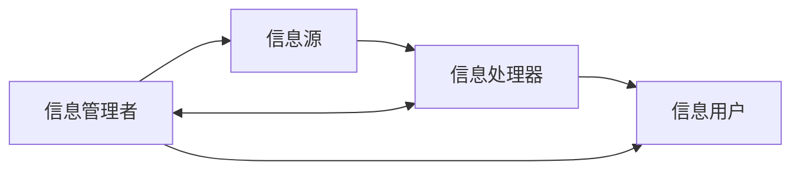
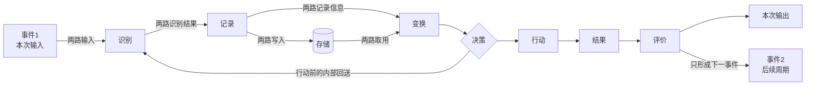
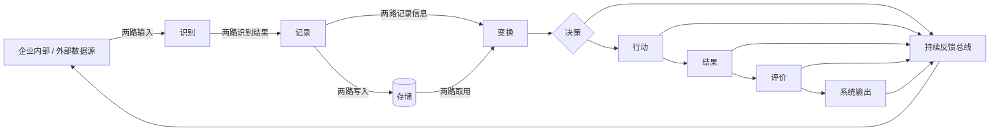
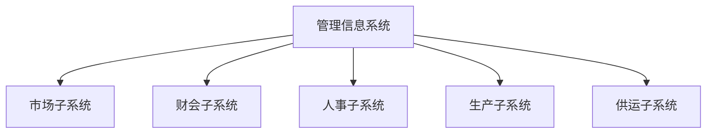
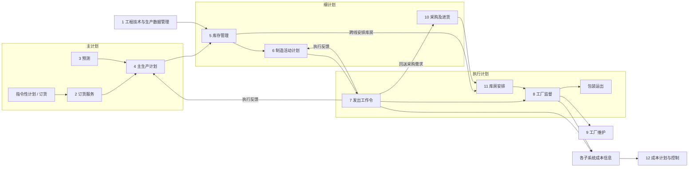
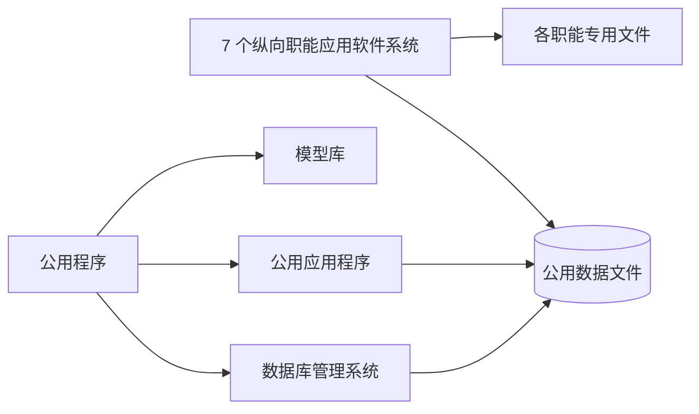

## 3.3 管理信息系统 (MIS)

管理信息系统 (Manage Information System,MIS) 是由业务处理系统发展而成的，是在TPS基础上引进大量管理方法对企业整体信息进行处理，并利用信息进行预测、控制、计划辅助企业全面管理的信息系统。从MIS应用的历史和现状来看，MIS是一个高度集成化的人机信息系统，它是企业信息系统中职能明确、体系结构较为稳定、处理技术成熟、应用也最为成功的分支。管理信息系统中包含各种模型和方法，数据共享能力更大，能够提供分析、计划和辅助决策功能的系统，并具有改进企业组织的效能。

### 3.3.1 管理信息系统的概念

从管理信息系统概念出发，管理信息系统由四大部件组成，即信息源、信息处理器、信息用户和信息管理者，见图 3-4。

> 图 3-4 管理信息系统总体结构
> **图表状态：** 教材原始图片资产未入库；下图依据官方教程 PDF 第 129 页（印刷页 119）结构化重绘，不是教材原图。

> **关系校对：** 原图的水平主链为“信息源 → 信息处理器 → 信息用户”；信息管理者与信息处理器双向联系，并分别单向指向信息源和信息用户。四个部件、五组有向关系均按官方教程 PDF 物理页 129（印刷页 119）转录；只省略弧线形状和版面位置。PDF SHA-256：`ee45900f4622d71539980cfe1bddbcd898fba97ca13ada6df1cbdc215135c2f8`；核对日期：2026-07-12。

开环和闭环。开环结构是在执行一个决策的过程中不收集外部信息，不根据信息情况改变决策，直至产生本次决策的结果，事后的评价只供以后的决策作参考。闭环结构是在决策过程中不断收集信息，不断发送给决策者，不断调整决策。事实上最后执行的决策已不是当初设想的决策，见图 3-5。

> 图 3-5 开环与闭环结构
> **图表状态：** 教材原始图片资产未入库；下图依据官方教程 PDF 第 129 页（印刷页 119）转录开环与闭环的共同处理链及反馈差异，不是教材原图。

开环结构：

闭环结构：

> **关系校对：** 两个子图都保留“识别—记录—变换—决策—行动—结果—评价”主链，以及记录写入存储、存储供变换取用的成对信息路径。开环图中，决策只能在行动前把内部信息回送到识别；评价不回送本次决策，而是生成下一周期的“事件2”。闭环图中，决策、行动、结果、评价及最终输出分别下接同一反馈总线，再回到企业内部/外部数据源，因此能在决策过程中持续调整。上述箭头与多路关系按官方教程 PDF 物理页 129（印刷页 119）逐线核对；虚线处理器边界和几何排版未复刻。PDF SHA-256：`ee45900f4622d71539980cfe1bddbcd898fba97ca13ada6df1cbdc215135c2f8`；核对日期：2026-07-12。

计算机实时处理的系统均属于闭环系统，而批处理系统均属于开环系统，但对于一些较长的决策过程来说批处理系统也能构成闭环系统。其次，根据处理的内容及决策的层次来看，我们可以把管理信息系统看成一个金字塔式的结构，见图 3-6。

组织管理均是分层次的，例如分为战略计划、管理控制和运行控制3层。由于战略计划一般是按职能分条的，信息系统也相应分为财务、生产、供应、人事及其他子系统。一般来说，下层的系统侧重运行控制，上层侧重战略计划，中间层侧重管理控制，形成纵横交织的金字塔结构，见图 3-6。

> 图 3-6 管理信息系统的金字塔结构
> **图表状态：** 教材原始图片资产未入库；下表依据官方教程 PDF 第 130 页（印刷页 120）把金字塔的纵向管理层次与横向职能条线转录为矩阵，不是教材原图。

| 管理层次（由上至下） | 销售与市场 | 生产 | 财务与会计 | 其他职能 |
|---|---|---|---|---|
| 战略计划 | 战略单元 | 战略单元 | 战略单元 | 战略单元 |
| 管理控制 | 管理单元 | 管理单元 | 管理单元 | 管理单元 |
| 运行控制 | 运行单元 | 运行单元 | 运行单元 | 运行单元 |
| 业务处理 | 业务单元 | 业务单元 | 业务单元 | 业务单元 |

> **结构说明：** 原图以宽底窄顶的金字塔表示业务处理量向下增大、战略处理量向上集中；斜向职能切面表示纵向综合，水平层表示横向综合，任一交叉区域可形成纵横综合子系统。

所以又有管理信息系统的纵向综合、横向综合以及纵横综合的概念。横向综合是按层划分子系统，纵向综合就是按条划分子系统。例如，把车间、科室以及总经理层的所有人事问题划分成一个子系统。纵横综合则是金字塔中任何一部分均可与任何其他部分组成子系统，达到随意组合自如使用的目的。

### 3.3.2 管理信息系统的功能

一个管理信息系统从使用者的角度看，它总是有一个目标，具有多种功能，各种功能之间又有各种信息联系，构成一个有机结合的整体，形成一个功能结构。例如，一个企业的内部管理系统可以具有图 3-7所示的结构。由图 3-7可以看出，这里子系统的名称所标注的是管理的子功能或职能，而不是计算机的名词。它说明管理信息系统能实现哪些管理功能。职能的完成往往是通过“过程”实现，过程

> 图 3-7 管理信息系统的功能结构
> **图表状态：** 教材原始图片资产未入库；下图依据官方教程 PDF 第 130 页（印刷页 120）结构化重绘，不是教材原图。

> **重建边界：** 五个职能子系统名称和从属关系按原页转录；原图的竖排文字改为横排节点。

是逻辑上相关活动的集合，因而往往把管理信息系统的功能结构表示成功能-过程结构，见图 3-8。

> 图 3-8 管理信息系统的功能-过程结构
> **图表状态：** 教材原始图片资产未入库；下图依据官方教程 PDF 第 130 页（印刷页 120）以及紧邻正文对 1～12 号系统的解释作结构化重绘，不是教材原图。

> **关系校对：** 原图顶端的时间范围分为“主计划—细计划—执行计划”，上图用三个分组保留该分段。除“主生产计划 → 库存管理 → 制造活动计划 → 发出工作令 → 工厂监督 → 包装运出”主链外，还逐线保留了库存管理跨接库房安排、发出工作令回送采购及进货、采购及进货到库房安排、发出工作令回到主生产计划/制造活动计划，以及发出工作令和工厂监督汇入“各子系统”成本信息后下接系统 12 的关系。系统 1 上接库存管理，工厂监督下接系统 9。关系与方向按官方教程 PDF 物理页 130（印刷页 120）核对；仅未复刻折线路由和节点坐标。PDF SHA-256：`ee45900f4622d71539980cfe1bddbcd898fba97ca13ada6df1cbdc215135c2f8`；核对日期：2026-07-12。

这个系统标明了企业各种功能子系统怎样互相联系并形成一个全企业的管理系统，是企业各种管理过程的一个缩影。整个流程自左至右展开，这里的企业主生产计划4是根据指令性计划、订货服务以及预测的结果来制订的。通过库存管理决定需要多少原料、半成品、外购件以及资金，而且确定物料的到达时间及库存水平。要产生这些信息用到的产品数据由系统1得到，根据系统5的安排，系统10决定何时进行采购和订货手续；系统11决定何时何地接收货物；

系统6决定何时何车间进行何种生产工作；系统6所安排的只是一个计划，只有通过系统7发出命令，一切工作才见行动；系统11在整个工作开始后，不断监视各种工作的完成情况，并进行调整和应急计划安排；最后进行包装并运出。图 3-8中的工厂维护系统9的功能是安排大修，系统12是进行成本计划与控制。

### 3.3.3 管理信息系统的组成

一个管理系统可用一个功能/层次矩阵表示，见图 3-9。

> 图 3-9 功能/层次矩阵
> **图表状态：** 教材原始图片资产未入库；下表依据官方教程 PDF 第 131 页（印刷页 121）转录矩阵行列，不是教材原图。

| 层次 \ 职能 | 销售市场 | 生产 | 后勤 | 人事 | 财务会计 | 信息处理 | 高层管理 |
|---|---|---|---|---|---|---|---|
| 战略计划 | 对应单元 | 对应单元 | 对应单元 | 对应单元 | 对应单元 | 对应单元 | 对应单元 |
| 管理控制 | 对应单元 | 对应单元 | 对应单元 | 对应单元 | 对应单元 | 对应单元 | 对应单元 |
| 运行控制 | 对应单元 | 对应单元 | 对应单元 | 对应单元 | 对应单元 | 对应单元 | 对应单元 |
| 业务处理 | 对应单元 | 对应单元 | 对应单元 | 对应单元 | 对应单元 | 对应单元 | 对应单元 |

> **重建边界：** 原图只定义行列交叉的功能/层次单元，没有在格内给出数值或状态；因此表中不填造具体业务内容。

图 3-9 的每一列代表一种管理功能。其实这种功能没有标准的分法，因组织不同而异。图中每一行表示一个管理层次，行列交叉表示每一种功能于系统。各个职能子系统的简要职能如下。

1. 销售市场子系统。它包括销售和推销，在运行控制方面包括雇用和训练销售人员、销售和推销的日常调度，还包括按区域、产品、顾客销售数量的定期分析等。在管理控制方面，包含总的成果和市场计划的比较，它所用的信息有顾客、竞争者、竞争产品和销售力量要求等。
在战略计划方面包含新市场的开发和战略，它使用的信息包含顾客分析、竞争者分析、顾客评价、收入预测、入口预测和技术预测等。

2. 生产子系统。它包括产品设计、生产设备计划、生产设备的调度和运行、生产人员的雇用和训练、质量控制和检查等。典型的业务处理是生产订货、装配订货、成品票、废品票和工时票等。运行控制要求将实际进度与计划相比较，发现问题环节；管理控制要求进行总进度、单位成本和工事消耗的计划比较；战略计划要考虑加工方法和自动化的方法。
3. 后勤子系统。它包括采购、收货、库存控制和分发。典型的业务包括采购的征收、采购订货、制造订货、收货报告、库存票、运输票和装货票、脱库项目、超库项目、库营业额报告、卖主性能总结、运输单位性能分析等。管理控制包括每一后勤工作的实际与计划的比较，如库存水平、采购成本、出库项目和库存营业额等；战略分析包括信息的分配战略分析、对卖主的新政策、“做或买”的战略、新技术信息、分配方案等。
4. 人事子系统。它包括雇用、培训、考核记录、工资和解雇等。其典型的业务有雇用需求的说明、工作岗位责任说明、培训说明、人员基本情况数据、工资变化、工作小时和离职说明等。运行控制关心的是雇佣、培训、终止、变化工资率、产生效果。管理控制主要进行实情与计划的比较，包括雇用数、招募费用、技术库存成分、培训费用、支付工资、工资率的分配和政府要求符合的情况。战略计划包括雇用战略和方案评价、工资、训练、收益、建筑位置及对留用人员的分析等，把本国的人员流动、工资率、教育情况和世界的情况进行比较。
5. 财务和会计子系统。按原理说财务和会计有不同的目标，财务的目标是保证企业的财务要求，并使其花费尽可能的低；会计则是把财务业务分类、总结，填入标准财务报告，准备预算、成本数据的分析与分类等。运行控制关心每天的差错和异常情况报告、延迟处理的报告和未处理业务的报告等；管理控制包括预算和成本数据的分析比较，如财务资源的实际成本，处理会计数据的成本和差错率等，战略计划关心的是财务保证的长期计划、减少税收影响的长期计划，成本会计和预算系统的计划。
6. 信息处理子系统。该系统的作用是保证企业的信息需要。典型的任务是处理请求、收集数据、改变数据和程序的请求、报告硬件和软件的故障及规划建议等。运行控制的内容包括日常任务调度、差错率、设备故障。对于新项目的开发还应当包括程序员的进展和调试时间。管理控制关心计划和实际的比较，如设备成本、全体程序员的水平、新项目的进度和计划的对比等。战略计划关心功能的组织是分散还是集中、信息系统总体计划、硬件软件的总体结构。办公室自动化也可算作与信息处理分开的一个子系统或者是合一的系统。当前办公室自动化主要的作用是支持知识工作和文书工作，如字符处理、电子信件、电子文件和数据与声音通信。
7. 高层管理子系统。每个组织均有一个最高领导层，如公司总经理和各职能域的副总经理组成的委员会，这个子系统主要为他们服务。其业务包括查询信息和支持决策，编写文件和信件便笺，向公司其他部门发送指令。运行控制层的内容包括会议进度、控制文件、联系文件。
管理控制层要求各功能子系统执行计划的总结和计划的比较等。战略计划层关心公司的方向和必要的资源计划。高层战略计划要求广泛而综合的外部信息和内部信息，这里可能包括特级数据检索和分析以及决策支持系统。它所需要的外部信息可能包括：竞争者的信息、区域经济指数、顾客的喜好、提供的服务质量等。

对应于这个管理系统，在管理信息系统中的软件系统或模块组成一个软件结构，见图 3-10。

图 3-10 中每个方块是一段程序块或是一个文件，每一个纵行是支持某一管理领域的软件系统。

> 图 3-10 管理信息系统的软件结构
> **图表状态：** 教材原始图片资产未入库；下表与关系图依据官方教程 PDF 第 133 页（印刷页 123）结构化转录，不是教材原图；原先混入正文的图内 OCR 标签串已删除。

| 纵向应用软件职能列 | 每列覆盖的管理层次 | 下接数据资产 |
|---|---|---|
| 销售市场 | 战略计划、管理控制、运行控制、业务处理 | 该职能专用文件；共享公用数据文件 |
| 生产 | 战略计划、管理控制、运行控制、业务处理 | 该职能专用文件；共享公用数据文件 |
| 后勤 | 战略计划、管理控制、运行控制、业务处理 | 该职能专用文件；共享公用数据文件 |
| 人事 | 战略计划、管理控制、运行控制、业务处理 | 该职能专用文件；共享公用数据文件 |
| 财务会计 | 战略计划、管理控制、运行控制、业务处理 | 该职能专用文件；共享公用数据文件 |
| 信息处理 | 战略计划、管理控制、运行控制、业务处理 | 该职能专用文件；共享公用数据文件 |
| 高层管理 | 战略计划、管理控制、运行控制、业务处理 | 该职能专用文件；共享公用数据文件 |

> **重建边界：** 纵向职能列、四个层次、专用/公用文件及右侧公用程序构成按原页转录；原图各程序块的高度和排列仅表示覆盖范围，本稿不把尺寸解释为数量或权重。