## 7.3 软件架构风格

软件体系结构设计的一个核心目标是重复的体系结构模式，即达到体系结构级的软件重用。也就是说，在不同的软件系统中使用同一体系结构。基于这个目标，主要任务是研究和实践软件体系结构风格和类型问题。

### 7.3.1 软件架构风格概述

软件体系结构风格是描述某一特定应用领域中系统组织方式的惯用模式。体系结构风格定义一个系统家族，即一个体系结构定义一个词汇表和一组约束。词汇表中包含一些构件和连接件类型，而这组约束指出系统是如何将这些构件和连接件组合起来的。体系结构风格反映了领域中众多系统所共有的结构和语义特性，并指导如何将各个模块和子系统有效地组织成一个完整的系统。对软件体系结构风格的研究和实践促进对设计的重用，一些经过实践证实的解决方案也可以可靠地用于解决新的问题。例如，如果某人把系统描述为“客户/服务器”模式，则不必给出设计细节，人们立刻就会明白系统是如何组织和工作的。

### 7.3.2 数据流体系结构风格

数据流体系结构是一种计算机体系结构，直接与传统的冯·诺依曼体系结构或控制流体系结构相对比。数据流体系结构没有概念上的程序计数器：指令的可执行性和执行仅基于指令输入参数的可用性来确定，因此，指令执行的顺序是不可预测的，即行为是不确定的。数据流体系结构风格主要包括批处理风格和管道-过滤器风格。

#### 1. 批处理体系结构风格

在批处理风格的软件体系结构中，每个处理步骤是一个单独的程序，每一步必须在前一步结束后才能开始，并且数据必须是完整的、以整体方式传递。它的基本构件是独立的应用程序，连接件是某种类型的媒介。连接件定义了相应的数据流图，表达拓扑结构。

> 图 7-7 批处理体系结构风格示意图（原图为数据验证、排序、更新、打印等批处理步骤及其数据流示意）

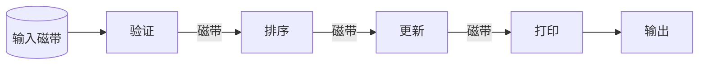

> **结构化重绘：** 各独立程序按“验证—排序—更新—打印”顺序执行，完整数据通过磁带等批处理媒介在相邻步骤间传递。

#### 2. 管道-过滤器体系结构风格

当数据源源不断地产生，系统就需要对这些数据进行若干处理(分析、计算、转换等)。现有的解决方案是把系统分解为几个序贯的处理步骤，这些步骤之间通过数据流连接，一个步骤的输出是另一个步骤的输入。每个处理步骤由一个过滤器(`Filter`)实现，处理步骤之间的数据传输由管道(`Pipe`)负责。每个处理步骤(过滤器)都有一组输入和输出，过滤器从管道中读取输入数据流，经过内部处理，然后产生输出数据流并写入管道中。因此，管道-过滤器风格的基本构件是过滤器，连接件是数据流传输管道，将一个过滤器的输出传到另一过滤器的输入。

> 图 7-8 管道/过滤器体系结构风格（原图略）

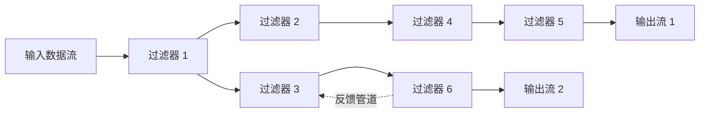

> **结构化重绘：** 方框代表过滤器、连线代表管道；原图同时给出分支、汇合和反馈路径，说明该风格并不限于单一直线流水线。

### 7.3.3 调用/返回体系结构风格

调用/返回风格是指在系统中采用了调用与返回机制。利用调用-返回实际上是一种分而治之的策略，其主要思想是将一个复杂的大系统分解为若干子系统，以便降低复杂度，并且增加可修改性。程序从其执行起点开始执行该构件的代码，程序执行结束后，将控制返回给程序调用构件。调用/返回体系结构风格主要包括主程序/子程序风格、面向对象风格、层次型风格以及客户端/服务器风格。

#### 1. 主程序/子程序风格

主程序/子程序风格一般采用单线程控制，把问题划分为若干处理步骤，构件即为主程序和子程序。子程序通常可合成为模块。过程调用作为交互机制，即充当连接件。调用关系具有层次性，其语义逻辑表现为子程序的正确性取决于它调用的子程序的正确性。

#### 2. 面向对象体系结构风格

抽象数据类型概念对软件系统有着重要作用，目前软件界已普遍转向使用面向对象系统。这种风格建立在数据抽象和面向对象的基础上，数据的表示方法和它们的相应操作封装在一个抽象数据类型或对象中。这种风格的构件是对象，或者说是抽象数据类型的实例。

> 图 7-9 面向对象体系结构风格（原图为对象、抽象数据类型与过程调用关系示意图）

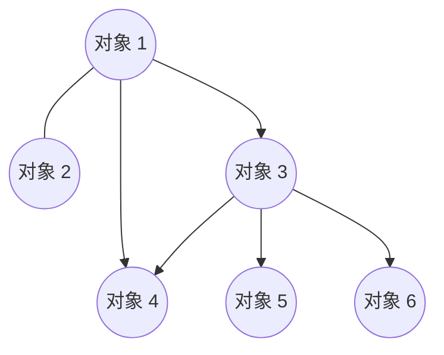

> **结构化重绘：** 各节点是对象（抽象数据类型的实例），对象之间通过过程调用协作；数据表示及其操作封装在对象内部。

#### 3. 层次型体系结构风格

层次系统组成一个层次结构，每一层为上层提供服务，并作为下层的客户。在一些层次系统中，除了一些精心挑选的输出函数外，内部的层接口只对相邻的层可见。这样的系统中，构件在层上实现了虚拟机。连接件由通过决定层间如何交互的协议来定义，拓扑约束包括对相邻层间交互的约束。由于每一层最多只影响两层，同时只要给相邻层提供相同的接口，就允许每层用不同的方法实现，这同样为软件重用提供了强大的支持。

> 图 7-10 层次型体系结构风格（原图为用户系统、基本工具、核心层等分层示意图）

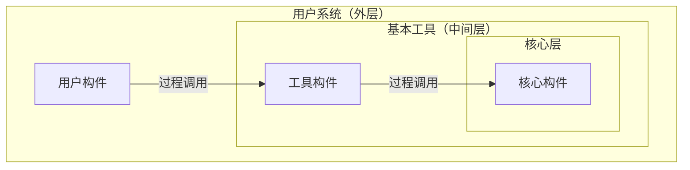

> **结构化重绘：** 原图以同心层表示用户系统、基本工具和核心层；每层由若干构件组成，并主要通过相邻层接口进行过程调用。

#### 4. 客户端/服务器体系结构风格

`C/S`(客户端/服务器)软件体系结构是基于资源不对等且为实现共享而提出的，在 20 世纪 90 年代逐渐成熟起来。两层 `C/S` 体系结构有 3 个主要组成部分：数据库服务器、客户应用程序和网络。服务器(后台)负责数据管理，客户机(前台)完成与用户的交互任务，称为“胖客户机，瘦服务器”。

> 图 7-11 C/S 体系结构风格（原图为主机、终端及网络关系示意图）

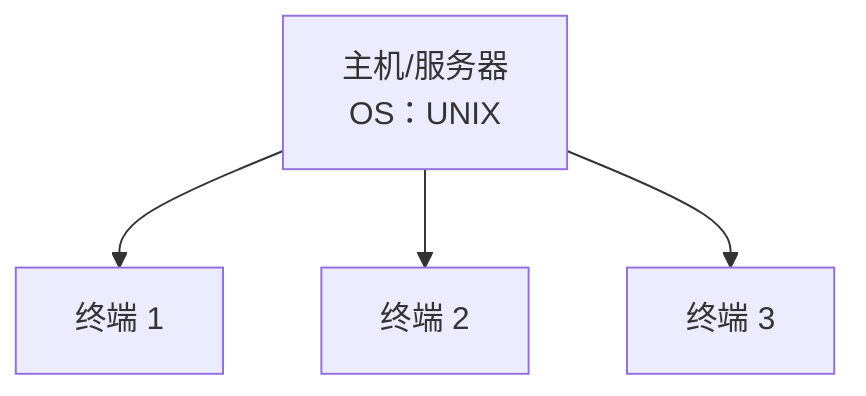

> **结构化重绘：** 原图用一台UNIX主机连接多个终端，表示服务器集中提供资源、终端负责用户交互的两层C/S关系。

与两层 `C/S` 结构相比，三层 `C/S` 结构增加了一个应用服务器。整个应用逻辑驻留在应用服务器上，只有表示层存在于客户机上，故称为“瘦客户机”。应用功能分为表示层、功能层和数据层三层。表示层是应用的用户接口部分，通常使用图形用户界面；功能层是应用的主体，实现具体的业务处理逻辑；数据层是数据库管理系统。以上三层逻辑上独立。

> 图 7-12 三层 C/S 体系结构风格（原图为工作站、应用服务器与数据库关系示意图）

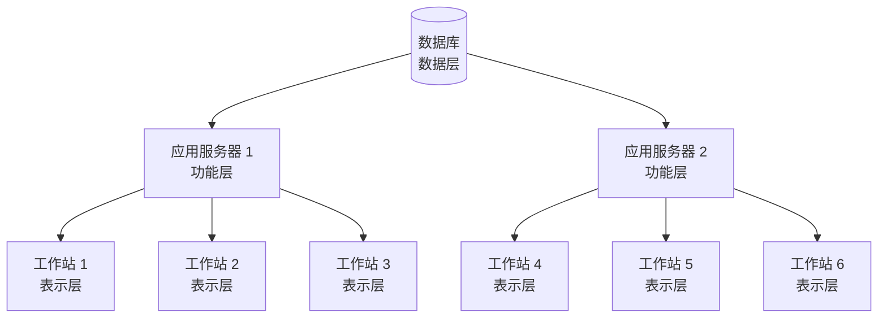

> **结构化重绘：** 多个工作站通过应用服务器访问统一数据库，对应逻辑上独立的表示层、功能层和数据层。

### 7.3.4 以数据为中心的体系结构风格

以数据为中心的体系结构风格主要包括仓库体系结构风格和黑板体系结构风格。

#### 1. 仓库体系结构风格

仓库(`Repository`)是存储和维护数据的中心场所。在仓库风格中，有两种不同的构件：中央数据结构说明当前数据的状态，以及一组对中央数据进行操作的独立构件。仓库与独立构件间的相互作用在系统中会有较大变化。这种风格的连接件，即为仓库与独立构件之间的交互。

> 图 7-13 仓库体系结构风格（原图为中央仓库与独立构件交互示意图）

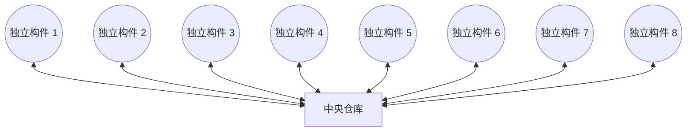

> **结构化重绘：** 中央数据结构保存系统状态；各独立构件不直接耦合，而是围绕仓库读写和维护共享数据。

#### 2. 黑板体系结构风格

黑板体系结构风格适用于解决复杂的非结构化问题，能在求解过程中综合运用多种不同知识源，使得问题的表达、组织和求解变得比较容易。黑板系统是一种问题求解模型，是组织推理步骤、控制状态数据和问题求解之领域知识的概念框架。它将问题的解空间组织成一个或多个应用相关的分级结构。分级结构的每一层信息由一个唯一的词汇来描述，它代表了问题的部分解。领域相关的知识被分成独立的知识模块，它将某一层次中的信息转换成同层或相邻层的信息。各种应用通过不同知识表达方法、推理框架和控制机制的组合来实现。

影响黑板系统设计的最大因素是应用问题本身的特性，但是支撑应用程序的黑板体系结构有许多相似的特征和构件。对于特定应用问题，黑板系统可通过选取各种黑板、知识源和控制模块的构件来设计，也可以利用预先定制的黑板体系结构编程环境。黑板系统的传统应用是信号处理领域，如语音识别和模式识别；另一应用是松耦合代理数据共享存取。

> 图 7-14 黑板体系结构风格（原图为黑板与知识源交互示意图）

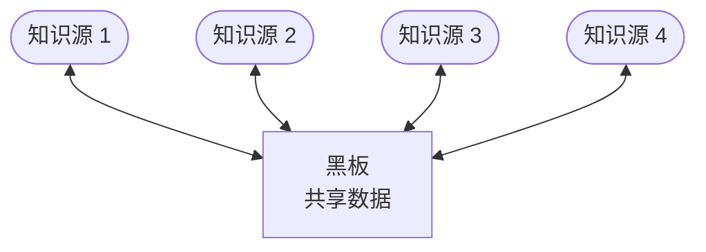

> **结构化重绘（2026-09-07 修订）：** 原图（官方教程 PDF 物理页 273）只含“黑板（共享数据）”与 4 个知识源及其“直接存取/计算/内存”等读写标注，不含独立的“控制机制/控制模块”节点；本重绘已删除此前版本增绘的控制机制节点与连线，只保留原图可见要素。黑板系统的控制机制属 7.3.4 正文概念描述，未画入原图。

### 7.3.5 虚拟机体系结构风格

虚拟机体系结构风格的基本思想是人为构建一个运行环境，在这个环境之上可以解析与运行自定义的一些语言，这样来增加架构的灵活性。虚拟机体系结构风格主要包括解释器风格和规则系统风格。

#### 1. 解释器体系结构风格

一个解释器通常包括完成解释工作的解释引擎、一个包含将被解释代码的存储区、一个记录解释引擎当前工作状态的数据结构，以及一个记录源代码被解释执行进度的数据结构。

具有解释器风格的软件中含有一个虚拟机，可以仿真硬件的执行过程和一些关键应用。解释器通常被用来建立一种虚拟机，以弥合程序语义与硬件语义之间的差异。其缺点是执行效率较低。典型的例子是专家系统。

> 图 7-15 解释器体系结构风格（原图为解释器引擎、状态机、数据存储和输入输出关系示意图）

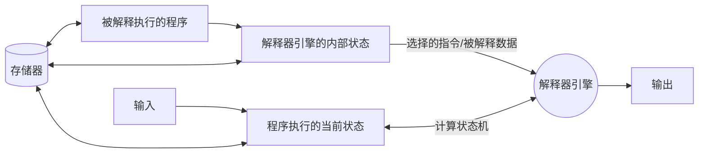

> **结构化重绘：** 解释器引擎从被解释程序和内部状态中选择指令与数据，依据当前执行状态计算下一状态，并产生输出；存储器保存程序及相关状态。

#### 2. 规则系统体系结构风格

基于规则的系统包括规则集、规则解释器、规则/数据选择器及工作内存。

> 图 7-16 规则系统体系结构风格（原图为知识库、规则集、事实集、工作内存与规则解释器关系示意图）

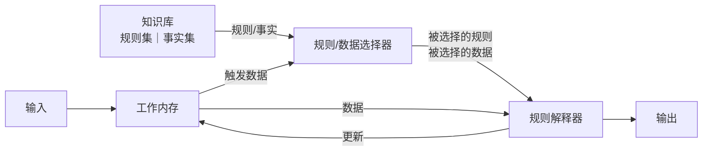

> **结构化重绘：** 选择器依据工作内存中的触发数据，从知识库选择规则和事实交给解释器；解释结果更新工作内存并产生输出。

### 7.3.6 独立构件体系结构风格

独立构件风格主要强调系统中的每个构件都是相对独立的个体，它们之间不直接通信，以降低耦合度，提升灵活性。独立构件风格主要包括进程通信和事件系统风格。

#### 1. 进程通信体系结构风格

在进程通信体系结构风格中，构件是独立的过程，连接件是消息传递。这种风格的特点是构件通常是命名过程，消息传递的方式可以是点到点、异步或同步方式及远程过程调用等。

#### 2. 事件系统体系结构风格

事件系统风格(见图7-17)基于事件的隐式调用风格的思想是构件不直接调用一个过程，而是触发或广播一个或多个事件。系统中的其他构件中的过程在一个或多个事件中注册，当一个事件被触发时，系统自动调用在这个事件中注册的所有过程。这样，一个事件的触发就导致了另一模块中的过程调用。

从架构上说，这种风格的构件是一些模块，这些模块既可以是一些过程，又可以是一些事件的集合。过程可以用通用的方式调用，也可以在系统事件中注册一些过程，当发生这些事件时，过程被调用。

基于事件的隐式调用风格的主要特点是事件的触发者并不知道哪些构件会被这些事件影响。这使得不能假定构件的处理顺序，甚至不知道哪些过程会被调用。因此，许多隐式调用的系统也包含显式调用，作为构件交互的补充形式。

支持基于事件的隐式调用的应用系统很多。例如，在编程环境中用于集成各种工具，在数据库管理系统中确保数据的一致性约束，在用户界面系统中管理数据，以及在编辑器中支持语法检查。例如在某系统中，编辑器和变量监视器可以登记相应 `Debugger` 的断点事件。当 `Debugger` 在断点处停下时，它声明该事件，由系统自动调用处理程序。这样，编辑器可以卷屏(返回)到断点，变量监视器刷新变量数值，而 `Debugger` 本身只声明事件，并不关心哪些过程会启动，也不关心这些过程做什么处理。

> 图 7-17 事件系统体系结构风格（原图为事件源、事件管理器、处理器与发布/分发关系示意图）

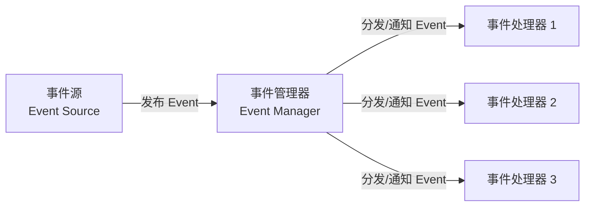

> **结构化重绘：** 事件源只负责发布事件，事件管理器向已注册的一个或多个处理器分发或通知，发布者无需知道具体接收者。