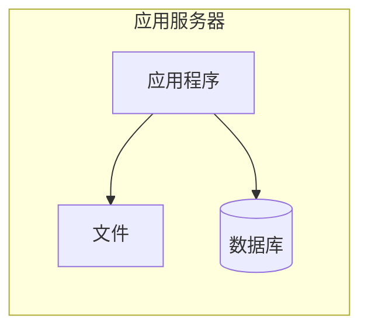
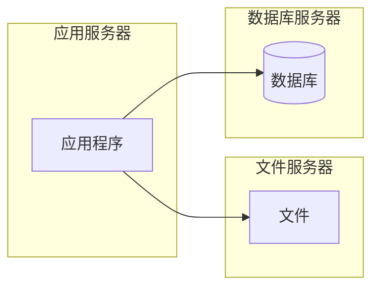
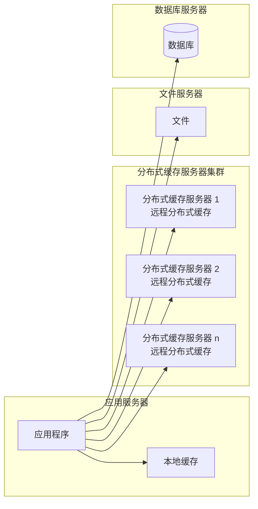
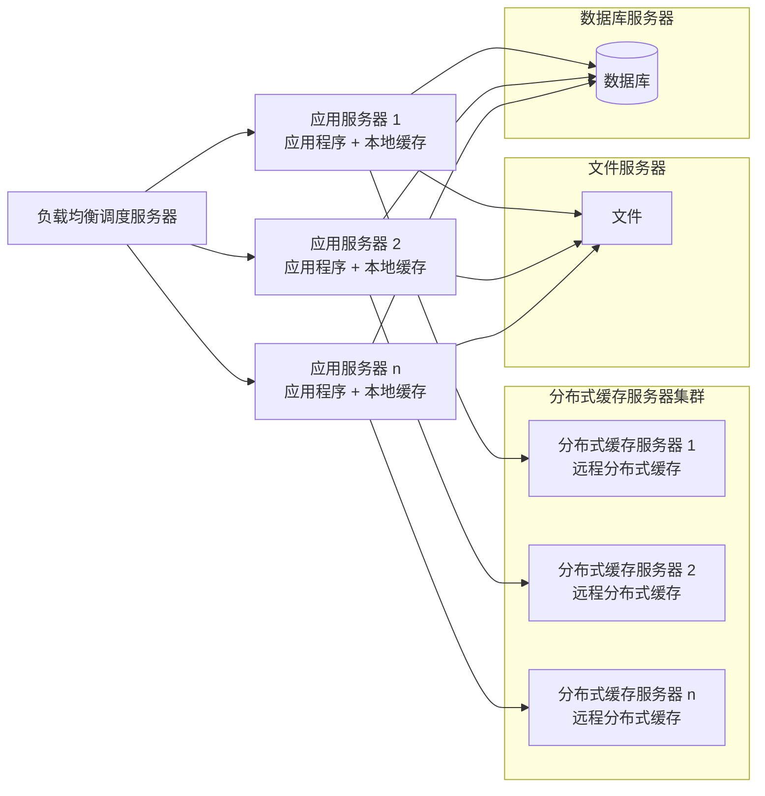
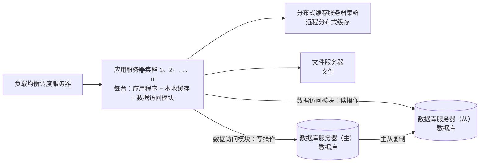
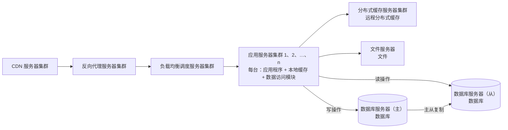
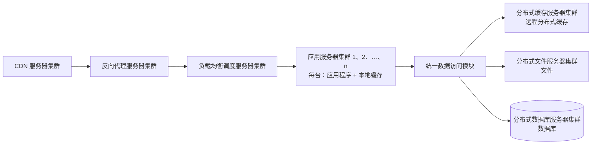
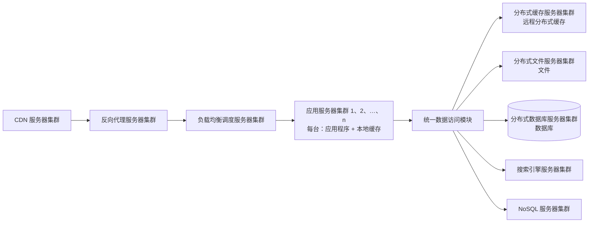
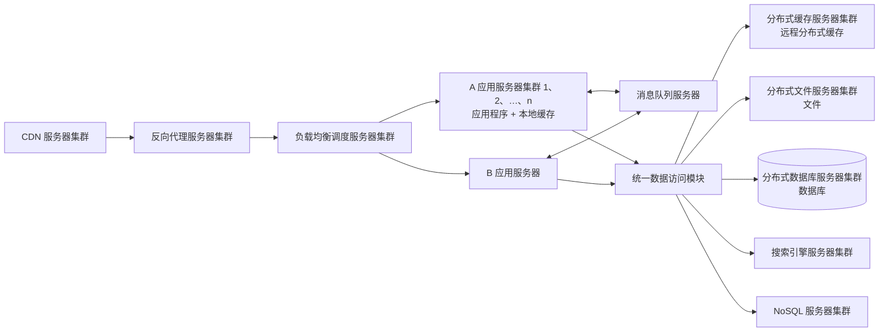
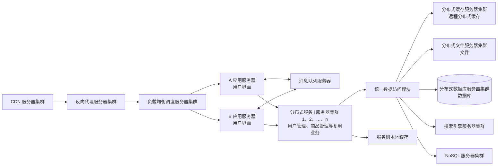

## 10.6 大型网站系统架构演化实例

大型网站的技术挑战主要来自庞大用户、高并发访问和海量数据。任何简单业务一旦需要处理海量数据并面对数以亿计用户，问题都会变得棘手。通常大型网站架构主要解决这类问题。

> **本节图形校对范围：** 图 10-10～图 10-19 均依据用户本地官方教程第 2 版 PDF 物理页 365～372(印刷页 355～362)逐图核对。以下 Mermaid 保留各阶段截至当时的累计组件、部署分组和主要连接关系，不只展示新增部分；节点位置、框体叠放、UML 图符和原版线条样式未复制，因此仍是结构化重绘而不是教材原图。

### 10.6.1 第一阶段：单体架构

大型网站都是从小型网站发展而来，网站架构也是一样，是从小型网站架构逐步演化而来。小型网站最开始没有太多人访问，只需要一台服务器就绰绰有余，这时应用程序、数据库、文件等所有资源都在同一台服务器上。

> 图 10-10 第一阶段网站架构
>
> **结构化重绘示意（不是教材原图）：** 根据 PDF 物理页 365 转录单台应用服务器内部的应用程序、文件和数据库三类资源及其访问关系。

### 10.6.2 第二阶段：垂直架构

随着网站业务发展，一台服务器逐渐不能满足需求，越来越多的用户访问导致性能越来越差，越来越多的数据导致存储空间不足，这时就需要将应用和数据分离。应用和数据分离后，整个网站通常使用 3 台服务器：应用服务器、文件服务器和数据库服务器。

三类服务器对硬件资源要求不同：

- 应用服务器需要处理大量业务逻辑，因此需要更快更强大的处理器。
- 数据库服务器需要快速磁盘检索和数据缓存，因此需要更快磁盘和更大内存。
- 文件服务器需要存储大量用户上传文件，因此需要更大容量硬盘。

应用与数据分离后，不同特性的服务器承担不同服务角色，网站的并发处理能力和数据存储空间得到很大改善，能够支持网站进一步发展。但随着用户继续增多，数据库压力会因访问延迟而影响整个网站性能，用户体验随之下降，网站架构还需要进一步优化。

> 图 10-11 第二阶段网站架构
>
> **结构化重绘示意（不是教材原图）：** 根据 PDF 物理页 365 转录应用服务器、文件服务器和数据库服务器分离后的完整部署关系。

### 10.6.3 第三阶段：使用缓存改善网站性能

网站访问的特点和现实世界财富分配一样遵循二八定律：80% 的业务访问集中在 20% 的数据上。因此，如果把这一小部分热点数据缓存在内存中，就可以减少数据库访问压力，提高整个网站的数据访问速度，并改善数据库写入性能。

网站缓存可以分为两种：

- 缓存在应用服务器上的本地缓存。
- 缓存在专门分布式缓存服务器上的远程缓存。

本地缓存访问速度更快，但受应用服务器内存限制，缓存数据量有限，而且会与应用程序竞争内存。远程分布式缓存可以采用集群方式，部署大内存服务器作为专门缓存服务器，理论上能够提供不受单机容量限制的缓存服务。

使用缓存后，数据库访问压力得到有效缓解，但单一应用服务器能够处理的请求连接有限；在网站访问高峰期，应用服务器会成为整个网站的新瓶颈。

> 图 10-12 第三阶段网站架构
>
> **结构化重绘示意（不是教材原图）：** 根据 PDF 物理页 366 转录应用服务器内的应用程序和本地缓存、分布式缓存服务器集群、文件服务器及数据库服务器的累计关系。

### 10.6.4 第四阶段：使用服务集群改善并发处理能力

使用集群是网站解决高并发、海量数据问题的常用手段。当一台服务器处理能力不足时，更恰当的做法不是一味更换更强大服务器，而是增加服务器来分担访问及存储压力。只要能通过增加一台服务器来改善负载压力，就可以用相同方式持续扩展，从而实现系统可伸缩性。

通过负载均衡调度服务器，可以把来自用户浏览器的访问请求分发到应用服务器集群中的任意一台服务器上。应用服务器数量增加后，单台应用服务器的负载不再成为整个网站的瓶颈，应用服务器集群也成为网站可伸缩架构设计中较为简单、成熟的一种实现。

> 图 10-13 第四阶段网站架构
>
> **结构化重绘示意（不是教材原图）：** 根据 PDF 物理页 366 完整转录负载均衡调度服务器、应用服务器集群(每台均含应用程序和本地缓存)、分布式缓存集群、文件服务器和数据库服务器；这是截至第四阶段的累计架构，不是单纯的“增加服务器”增量图。

### 10.6.5 第五阶段：数据库读写分离

网站在使用缓存后，大部分读操作可不经过数据库完成，但仍有一部分读操作和全部写操作需要访问数据库。当用户达到一定规模后，数据库会因负载压力过高而成为瓶颈。于是利用数据库主从热备功能，实现数据库读写分离。

应用服务器在写数据时访问主数据库；主数据库通过主从复制机制将数据同步到从数据库；而应用服务器读数据时则访问从数据库。为了便于应用程序访问读写分离后的数据库，通常在应用服务器端使用专门的数据访问模块，使读写分离对应用透明。

> 图 10-14 第五阶段网站架构
>
> **结构化重绘示意（不是教材原图）：** 根据 PDF 物理页 367 转录截至第五阶段的完整架构：负载均衡、带本地缓存和数据访问模块的应用服务器集群、分布式缓存、文件服务器，以及主库写入、从库读取和主从复制关系。

### 10.6.6 第六阶段：使用反向代理和 CDN 加速网站响应

随着用户规模增大，不同地区用户的网络环境差异使访问速度差别明显。为了提升用户体验，需要加速网站访问速度。主要手段有使用 `CDN` 和反向代理。

- `CDN` 部署在网络提供商机房，使用户从距离自己最近的节点获取数据。
- 反向代理部署在网站中心机房，请求先访问反向代理服务器，如果缓存中已有资源，则直接返回给用户。

二者本质上都是“尽早返回数据给用户”，既加快访问速度，也减轻后端服务器压力。

> 图 10-15 第六阶段网站架构
>
> **结构化重绘示意（不是教材原图）：** 根据 PDF 物理页 368 转录 CDN、反向代理、负载均衡、应用集群、缓存、文件和主从数据库组成的累计架构；CDN 与反向代理位于负载均衡之前。

### 10.6.7 第七阶段：使用分布式文件系统和分布式数据库系统

任何单一强大服务器都无法满足大型网站持续增长的业务需求。数据库经过读写分离后，从一台服务器拆成两台服务器，但随着业务发展仍然不够，这时就需要使用分布式数据库。文件系统也一样，需要使用分布式文件系统。

分布式数据库是网站数据库拆分的最后手段，通常只在单表数据规模非常庞大时使用。不到万不得已时，网站更常用的数据库拆分方式是业务分库，把不同业务的数据部署在不同物理服务器上。

> 图 10-16 第七阶段网站架构
>
> **结构化重绘示意（不是教材原图）：** 根据 PDF 物理页 369 转录 CDN、反向代理、负载均衡、应用集群及其统一数据访问模块，并把后端完整展开为分布式缓存、分布式文件和分布式数据库集群。

### 10.6.8 第八阶段：使用 NoSQL 和搜索引擎

随着网站业务越来越复杂，对数据存储和检索的需求也越来越复杂，网站需要采用一些非关系数据库技术如 `NoSQL`，以及非数据库查询技术如搜索引擎。`NoSQL` 和搜索引擎都源自互联网技术栈，对可伸缩的分布式特性具有更好支持。应用服务器则通过统一数据访问模块访问各种数据，减轻应用程序管理诸多数据源的负担。

> 图 10-17 第八阶段网站架构
>
> **结构化重绘示意（不是教材原图）：** 根据 PDF 物理页 370 在第七阶段累计架构上补入搜索引擎与 NoSQL，并保留统一数据访问模块对全部后端数据源的屏蔽关系。

### 10.6.9 第九阶段：业务拆分

大型网站为了应对日益复杂的业务场景，通过分而治之手段将整个网站业务拆分为不同产品线。例如大型购物网站会将首页、商铺、订单、买家、卖家等拆分成不同产品线，分归不同业务团队负责。

在技术上，也会根据产品线划分，将一个网站拆成多个不同应用，每个应用独立部署。应用之间可以通过超链接建立关系，也可以通过消息队列进行数据分发，还可以通过访问同一数据存储系统构成一个关联的完整系统。

> 图 10-18 第九阶段网站架构
>
> **结构化重绘示意（不是教材原图）：** 根据 PDF 物理页 371 转录产品线拆分后的 A、B 两组应用、消息队列和既有完整技术底座。超链接属于正文说明但未在原图中单列节点，故保留在正文，不额外伪造图内连线。

### 10.6.10 第十阶段：分布式服务

随着业务拆分越来越细，存储系统越来越庞大，应用系统整体复杂度呈指数级增加，部署维护越来越困难。既然每一个应用系统都需要执行许多相同业务操作，比如用户管理、商品管理等，那么可以将这些共用业务提取出来，独立部署。由这些可复用业务连接数据库，提供共用业务服务，而应用系统只负责用户界面，通过分布式服务调用共用业务服务完成具体业务操作。

> 图 10-19 第十阶段网站架构
>
> **结构化重绘示意（不是教材原图）：** 根据 PDF 物理页 372 转录 A、B 应用、消息队列、分布式服务集群及既有缓存、文件、数据库、搜索和 NoSQL 底座。应用侧保留用户界面，复用业务进入分布式服务层，并由服务层统一访问数据资源。

大型网站的架构演化到这里，基本上大多数技术问题都得以解决。跨数据中心的数据同步和具体业务相关的问题，则可以通过在现有技术架构上进行组合和改进来解决。